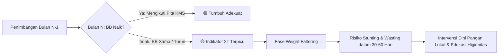
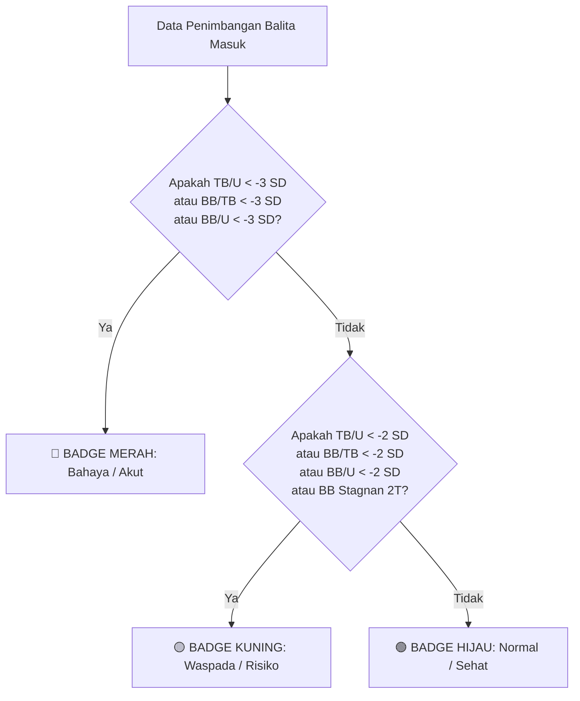

# 📘 Panduan Bisnis & Logika Klinis: Perhitungan Stunting (WHO Z-Score)

Dokumen ini menjelaskan secara komprehensif latar belakang bisnis, dasar medis, formula statistik, ambang batas klinis, dan implementasi teknis penentuan status **Stunting** serta status gizi anak pada platform **TUMBUH**.

---

## 📑 Daftar Isi
1. [Konteks Bisnis & Dampak Publik](#1-konteks-bisnis--dampak-publik)
2. [Dasar Regulasi & Standar Baku](#2-dasar-regulasi--standar-baku)
3. [Perbedaan Stunting, Wasting, dan Underweight](#3-perbedaan-stunting-wasting-dan-underweight)
4. [Konsep Statistik & Formula Z-Score WHO](#4-konsep-statistik--formula-z-score-who)
5. [Tabel Klasifikasi & Ambang Batas (Cut-Off Points)](#5-tabel-klasifikasi--ambang-batas-cut-off-points)
6. [Aturan 2T (Weight Faltering / Berat Badan Stagnan)](#6-aturan-2t-weight-faltering--berat-badan-stagnan)
7. [Logika Triase Warna Badge (Live Preview Posyandu)](#7-logika-triase-warna-badge-live-preview-posyandu)
8. [Simulasi Perhitungan Kasus Nyata](#8-simulasi-perhitungan-kasus-nyata)
9. [Implementasi Kode di Platform TUMBUH](#9-implementasi-kode-di-platform-tumbuh)
10. [Integrasi dengan AI Clinical Nutrition Advisor](#10-integrasi-dengan-ai-clinical-nutrition-advisor)

---

## 1. Konteks Bisnis & Dampak Publik

### Apa itu Stunting?
**Stunting** adalah gangguan pertumbuhan dan perkembangan anak akibat **kekurangan gizi kronis** dan/atau **infeksi berulang**, yang ditandai dengan panjang atau tinggi badannya berada di bawah standar baku nasional/internasional.

### Mengapa Perhitungan Otomatis Sangat Krusial di Posyandu?
1. **Periode Emas 1.000 Hari Pertama Kehidupan (HPK):**
   Kerusakan perkembangan otak akibat stunting bersifat **ireversibel (tidak dapat diperbaiki)** setelah anak melewati usia 2 tahun (24 bulan).
2. **Keterbatasan Kader Posyandu di Lapangan:**
   Di Posyandu konvensional, kader harus memplot titik secara manual pada buku KMS fisik bergaris sempit. Risiko kesalahan pembacaan garis (*human error*) sangat tinggi, sehingga kasus balita yang mulai melambat laju tumbuhnya sering terlewatkan (*underdiagnosed*).
3. **Mendukung SDG 2 & SDG 3:**
   Platform mengotomatiskan triase sehingga tenaga kesehatan komunitas dapat segera mengintervensi balita berisiko sebelum jatuh ke kondisi gizi buruk permanen.

---

## 2. Dasar Regulasi & Standar Baku

Platform TUMBUH mengacu penuh pada instrumen legal dan standar klinis resmi:

1. **Peraturan Menteri Kesehatan Republik Indonesia (Permenkes RI) No. 2 Tahun 2020** tentang *Standar Antropometri Anak*.
2. **World Health Organization (WHO) Child Growth Standards 2006** (*Multicentre Growth Reference Study / MGRS*) untuk populasi anak usia 0 hingga 60 bulan (5 tahun).
3. **Petunjuk Teknis Pemberian Makanan Tambahan (PMT) Berbahan Pangan Lokal Kemenkes RI 2023**.

---

## 3. Perbedaan Stunting, Wasting, dan Underweight

Sering terjadi kerancuan antara stunting dan kurus. Ketiganya mencerminkan kondisi biologis yang berbeda:

| Istilah Klinis | Indeks Antropometri | Definisi Medis | Sifat Masalah |
| :--- | :--- | :--- | :--- |
| **Stunting (Pendek)** | **TB/U** (Tinggi menurut Umur) | Hambatan pertumbuhan linier tulang panjang akibat defisiensi gizi berkepanjangan. | **Kronis (Jangka Panjang)** |
| **Wasting (Kurus/Gizi Buruk)** | **BB/TB** (Berat menurut Tinggi) | Penurunan massa otot dan lemak tubuh akibat kelaparan akut atau penyakit infeksi berat (diare, TBC). | **Akut (Jangka Pendek)** |
| **Underweight (Berat Kurang)** | **BB/U** (Berat menurut Umur) | Berat badan total tidak mencukupi untuk usianya. Gabungan dari masalah kronis dan/atau akut. | **Komposit / Umum** |

> **Catatan Penting:** Anak yang mengalami stunting **belum tentu berbadan kurus**; proporsi tubuhnya bisa terlihat gemuk atau normal, tetapi tinggi badannya jauh lebih pendek dari anak sebaya.

---

## 4. Konsep Statistik & Formula Z-Score WHO

### Mengapa Menggunakan Z-Score?
Pertumbuhan anak tidak mengikuti kurva linier sederhana, melainkan kurva distribusi normal standar Gauss. Penggunaan *persentil* atau *persentase median* konvensional memiliki kelemahan distorsi di area ekstrem bawah. **Z-Score (Standard Deviation Score / SD)** menunjukkan seberapa jauh deviasi ukuran seorang anak dari nilai median populasi sehat WHO dalam satuan simpangan baku ($SD$).

### Formula Perhitungan Z-Score
Karena kurva pertumbuhan biologis manusia bersifat asimetris (sedikit condong / *skewed*), WHO menggunakan simpangan baku yang berbeda untuk nilai di atas median dan di bawah median:

$$
Z\text{-Score} = \frac{y - \text{Median}}{SD}
$$

Di mana nilai simpangan baku ($SD$) dihitung sebagai berikut:

1. **Jika Nilai Ukur ($y$) $\ge$ Median:**
   $$SD = \frac{SD_{+2} - \text{Median}}{2}$$
   
2. **Jika Nilai Ukur ($y$) $<$ Median:**
   $$SD = \frac{\text{Median} - SD_{-2}}{2}$$

*Keterangan:*
- $y$ = Hasil pengukuran riil anak (Tinggi Badan dalam cm atau Berat Badan dalam kg).
- $\text{Median}$ = Nilai median baku WHO (0 SD) untuk jenis kelamin dan umur bulan tersebut.
- $SD_{+2}$ = Batas atas baku WHO (+2 SD).
- $SD_{-2}$ = Batas bawah baku WHO (-2 SD).

---

## 5. Tabel Klasifikasi & Ambang Batas (Cut-Off Points)

Sesuai standar Permenkes No. 2 Tahun 2020:

### A. Indeks Tinggi Badan menurut Umur (TB/U) — *Penentu Status Stunting*
| Rentang Z-Score | Klasifikasi Status | Label Bahasa Indonesia | Status Klinis |
| :--- | :--- | :--- | :--- |
| **$Z < -3.0\text{ SD}$** | `severely_stunted` | **Sangat Pendek (*Severely Stunted*)** | 🔴 Bahaya (Darurat Rujukan Sp.A) |
| **$-3.0\text{ SD} \le Z < -2.0\text{ SD}$** | `stunted` | **Pendek (*Stunted*)** | 🟡 Waspada Intervensi Protein Hewani |
| **$-2.0\text{ SD} \le Z \le +2.0\text{ SD}$** | `normal` | **Normal** | 🟢 Sehat / Sesuai Pertumbuhan |
| **$Z > +2.0\text{ SD}$** | `tall` | **Tinggi** | 🟢 Normal / Di Atas Rata-rata |

---

### B. Indeks Berat Badan menurut Umur (BB/U) — *Penentu Berat Badan*
| Rentang Z-Score | Klasifikasi Status | Label Bahasa Indonesia |
| :--- | :--- | :--- |
| **$Z < -3.0\text{ SD}$** | `severely_underweight` | Berat Badan Sangat Kurang |
| **$-3.0\text{ SD} \le Z < -2.0\text{ SD}$** | `underweight` | Berat Badan Kurang |
| **$-2.0\text{ SD} \le Z \le +1.0\text{ SD}$** | `normal` | Berat Badan Normal |
| **$Z > +1.0\text{ SD}$** | `risk_of_overweight` | Risiko Berat Badan Lebih |

---

### C. Indeks Berat Badan menurut Tinggi Badan (BB/TB) — *Penentu Wasting / Gizi Buruk*
| Rentang Z-Score | Klasifikasi Status | Label Bahasa Indonesia |
| :--- | :--- | :--- |
| **$Z < -3.0\text{ SD}$** | `severely_wasted` | Gizi Buruk (*Severely Wasted*) |
| **$-3.0\text{ SD} \le Z < -2.0\text{ SD}$** | `wasted` | Gizi Kurang (*Wasted*) |
| **$-2.0\text{ SD} \le Z \le +1.0\text{ SD}$** | `normal` | Gizi Baik (Normal) |
| **$+1.0\text{ SD} < Z \le +2.0\text{ SD}$** | `risk_of_overweight` | Berisiko Gizi Lebih |
| **$+2.0\text{ SD} < Z \le +3.0\text{ SD}$** | `overweight` | Gizi Lebih (*Overweight*) |
| **$Z > +3.0\text{ SD}$** | `obese` | Obesitas |

---

## 6. Aturan 2T (Weight Faltering / Berat Badan Stagnan)

Dalam praktik Posyandu Kemenkes RI, deteksi dini stunting **tidak boleh menunggu** hingga anak berstatus $Z < -2.0\text{ SD}$.

### Apa itu Aturan 2T?
**2T = Tidak Naik Berat Badan dalam 2 Kali Pengukuran Berurutan.**

Anak yang mengalami *Weight Faltering* (berat badan mendatar atau turun):
$$\text{Berat Sekarang} \le \text{Berat Bulan Lalu}$$



*Logika Medis:* Pertumbuhan linier tulang (tinggi badan) bergantung pada cadangan energi jaringan lunak (berat badan). Jika berat badan terhenti (stagnan), tubuh anak akan menghentikan laju pertumbuhan tinggi badannya sebagai mekanisme bertahan hidup, memicu stunting 1–2 bulan berikutnya.

---

## 7. Logika Triase Warna Badge (Live Preview Posyandu)

Pada antarmuka input cepat kader (`/kader/measurements/batch`), platform menghitung triase warna secara instan menggunakan logika berikut:



- 🔴 **Merah (Bahaya / Masalah Akut):** Terindikasi *Severely Stunted* atau *Severely Wasted*. Harus segera dirujuk ke Dokter Spesialis Anak di RSUD/Puskesmas.
- 🟡 **Kuning (Waspada / Risiko Stunting):** Terindikasi *Stunted* atau berat badan stagnan (aturan 2T). Memerlukan pendampingan PMT protein hewani intensif.
- 🟢 **Hijau (Aman):** Pertumbuhan sesuai kurva rujukan WHO.

---

## 8. Simulasi Perhitungan Kasus Nyata

### Kasus: Balita Perempuan Bernama "Aisyah"
- **Usia saat penimbangan:** 18 Bulan
- **Jenis Kelamin:** Perempuan (`female`)
- **Tinggi Badan:** 76.0 cm
- **Berat Badan:** 8.6 kg

#### Langkah 1: Ambil Standar Rujukan Baku WHO (Usia 18 Bulan, Perempuan)
Dari database acuan WHO (`growth_standards.json`):
- $\text{Median (0 SD)} = 80.7\text{ cm}$
- $SD_{-2} = 74.9\text{ cm}$
- $SD_{+2} = 86.5\text{ cm}$

#### Langkah 2: Hitung Simpangan Baku ($SD$)
Karena Tinggi Riil ($76.0\text{ cm}$) $<$ Median ($80.7\text{ cm}$), gunakan simpangan bawah:
$$SD = \frac{\text{Median} - SD_{-2}}{2} = \frac{80.7 - 74.9}{2} = \frac{5.8}{2} = 2.9$$

#### Langkah 3: Hitung Z-Score TB/U
$$Z\text{-Score} = \frac{76.0 - 80.7}{2.9} = \frac{-4.7}{2.9} \approx -1.62\text{ SD}$$

*(Jika pada riwayat sebelumnya tinggi badannya hanya 74.0 cm pada usia 18 bulan, maka:)*
$$Z\text{-Score} = \frac{74.0 - 80.7}{2.9} = \frac{-6.7}{2.9} \approx -2.31\text{ SD}$$

#### Langkah 4: Tentukan Klasifikasi
Nilai $-2.31\text{ SD}$ berada di rentang $-3.0\text{ SD} \le Z < -2.0\text{ SD}$.
👉 **Hasil:** `stunted` (**Pendek / Stunted**).

---

## 9. Implementasi Kode di Platform TUMBUH

Seluruh logika di atas dienkapsulasi dalam service [`App\Services\WhoGrowthService`](file:///home/wafiulachdi/kuliah/pemrograman-web/tumbuh/app/Services/WhoGrowthService.php).

### Potongan Kode Inti:
```php
public function calculateZScoreTbU(string $gender, int $ageInMonths, float $height): array
{
    $genderKey = strtolower($gender) === 'female' ? 'female' : 'male';
    $ageClamped = max(0, min(60, $ageInMonths));

    $ref = $this->standards['tb_u'][$genderKey][(string) $ageClamped] ?? null;

    if (!$ref) {
        return ['zScore' => 0.0, 'status' => 'normal', 'label' => 'Normal'];
    }

    $median   = (float) $ref['median'];
    $sdMinus2 = (float) $ref['sd_minus_2'];
    $sdPlus2  = (float) $ref['sd_plus_2'];

    // Perhitungan unit simpangan baku asimetris
    if ($height >= $median) {
        $sd = ($sdPlus2 - $median) / 2.0;
    } else {
        $sd = ($median - $sdMinus2) / 2.0;
    }

    $sd = $sd > 0 ? $sd : 1.0;
    $zScore = round(($height - $median) / $sd, 2);

    // Pemetaan ambang batas WHO / Permenkes
    if ($zScore < -3.0) {
        $status = 'severely_stunted';
        $label  = 'Sangat Pendek (Severely Stunted)';
    } elseif ($zScore < -2.0) {
        $status = 'stunted';
        $label  = 'Pendek (Stunted)';
    } elseif ($zScore <= 2.0) {
        $status = 'normal';
        $label  = 'Normal';
    } else {
        $status = 'tall';
        $label  = 'Tinggi';
    }

    return [
        'zScore' => $zScore,
        'status' => $status,
        'label'  => $label,
    ];
}
```

---

## 10. Integrasi dengan AI Clinical Nutrition Advisor

Hasil Z-Score dan deteksi 2T secara otomatis menjadi input deterministik ke dalam prompt **Gemini AI / Fallback Engine** ([`AiNutritionService`](file:///home/wafiulachdi/kuliah/pemrograman-web/tumbuh/app/Services/AiNutritionService.php)):

1. **Trigger Rujukan Medis:**
   Jika `zScoreTbU < -2.0` atau `isWeightStagnant == true`, flag `shouldReferToPuskesmas` otomatis bernilai `true`.
2. **Formulasi Menu Pangan Lokal Presisi:**
   - Untuk balita terindikasi stunting, AI otomatis memprioritaskan pangan hewani kaya asam amino esensial (*leusin*) untuk menstimulasi hormon pertumbuhan tulang **IGF-1 (Insulin-like Growth Factor 1)**, seperti:
     - Telur ayam / puyuh (sarapan).
     - Hati ayam kampung kaya zat besi *heme* (makan siang).
     - Ikan air tawar/laut murah (lele, kembung kaya Omega-3) (makan malam).
3. **Penyusunan Anggaran Taktis:**
   Membagi alokasi anggaran harian keluarga (misal Rp20.000) agar realistis dibeli di pasar tradisional tanpa membebani ekonomi orang tua balita.
